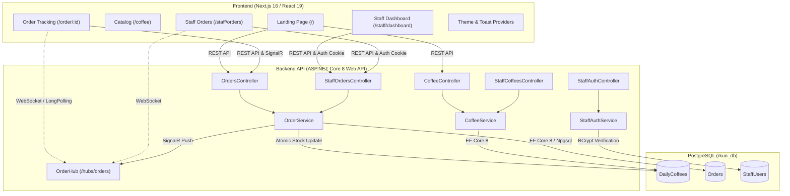
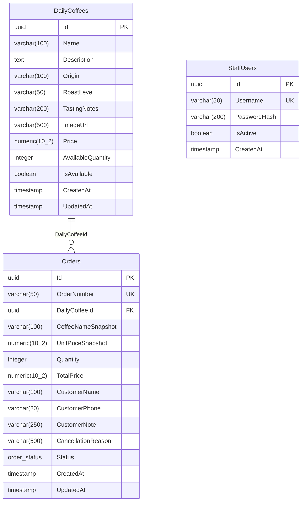
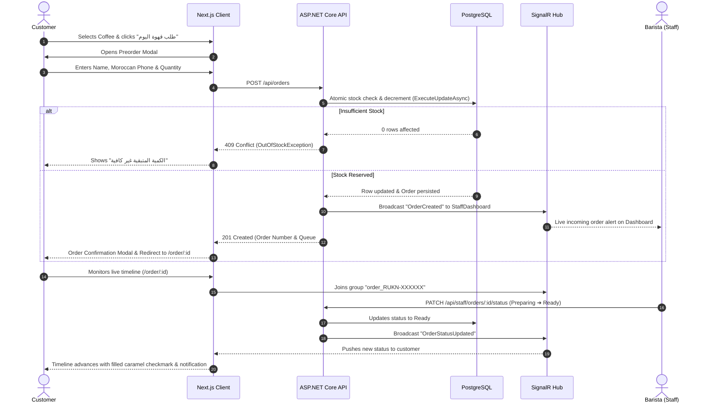

# S-07 — Rukn (رُكن) Specialty Coffee Preorder Platform

**Rukn (رُكن)** is an Arabic-first, real-time specialty coffee preorder web application designed for a specialty coffee shop in Morocco. The café offers a daily single-origin coffee bean roasted in limited quantities. Customers discover today's roast, place rapid preorders without mandatory registration, receive a trackable reference code, and monitor order progression in real-time. Baristas manage active orders, update statuses, adjust inventory, and review daily sales analytics through a dedicated operational dashboard.

---

## 1. Technology Stack

### Backend
- **Framework**: .NET 8 (`net8.0`) / ASP.NET Core Web API
- **Language**: C# 12
- **Database**: PostgreSQL
- **ORM & Migrations**: Entity Framework Core 8 (`Npgsql.EntityFrameworkCore.PostgreSQL` v8.0.2)
- **Real-Time Communication**: ASP.NET Core SignalR (`/hubs/orders`)
- **Authentication**: ASP.NET Core Cookie Authentication (`HttpOnly`, `SameSite=Lax`)
- **Password Hashing**: `BCrypt.Net-Next` (Work Factor 11)
- **Documentation**: Swagger / OpenAPI (`Swashbuckle.AspNetCore` v6.6.2)

### Frontend
- **Framework**: Next.js 16.4.6 (App Router with Turbopack)
- **Library**: React 19.3.0
- **Language**: TypeScript 5 (Strict Mode enabled)
- **Styling**: Tailwind CSS v4.3.3
- **Charts & Visualization**: Recharts v3.11.0 with `react-is` v19.3.1
- **Icons**: Lucide React v1.77.0
- **Real-Time Client**: `@microsoft/signalr` v11.0.0
- **Typography**: Google Fonts `IBM Plex Sans Arabic` (RTL native)

---

## 2. Features

### Customer Features
- **Featured Coffee Discovery**: View today's exclusive coffee (`/api/coffee/today`), tasting notes, roast level, country of origin, price in MAD, and available cup inventory.
- **Coffee Catalog (`/coffee`)**: Browse the curated archive of specialty coffees with quick modal ordering.
- **Instant Preorder Modal**: Order directly in a popup modal with customer name, Moroccan phone validation (`05/06/07...`), quantity selector, and optional notes.
- **Stock Depletion Guards**: Instant visual feedback and server-side atomic stock rejection if the requested quantity exceeds inventory.
- **Order Queue Counter**: Real-time counter showing the customer's current position in the preparation queue (`#X`).
- **Live Order Tracking (`/order/[id]`)**: Real-time 4-stage visual timeline (جديد ➔ قيد التحضير ➔ جاهز للاستلام ➔ تم التسليم) animated with SignalR pushes.
- **Customer Cancellation**: Self-service order cancellation while the order is still `New` or `Preparing`, with mandatory reason selection.
- **Look Up by Reference (`/track`)**: Clean search input accepting order references (`RUKN-YYYYMMDD-XXXXXX`).
- **Theme Switcher**: Instant toggle between specialty coffee Light and Dark modes.

### Staff Features
- **Secure Authentication (`/staff/login`)**: Cookie-based login with persistent sessions and server-side validation.
- **Operational Dashboard (`/staff/dashboard`)**:
  - Top KPI cards: Total orders, today's revenue, active preparations, ready orders, and low-stock alerts.
  - Interactive Recharts analytics: Responsive daily revenue Area Chart (7d, 30d, this month), daily orders Bar Chart, and order status Donut Chart.
  - Recent orders feed and today's coffee quick status.
  - Refined Arabic date pill badge (`الأحد، 22 نوفمبر 2026`).
- **Order Management (`/staff/orders`)**:
  - Filter orders by status (`All`, `New`, `Preparing`, `Ready`, `Completed`, `Cancelled`) and search by customer name/phone/reference.
  - One-tap status advancement (`بدء التحضير`, `تأكيد الجاهزية`, `تأكيد التسليم`).
  - Restrained order cancellation button with confirmation dialog and preset reasons.
  - Detailed modal view for reviewing customer notes and time stamps.
- **Coffee Management (`/staff/coffees`)**: Complete CRUD operations for coffee products and inventory quantities.
- **Profile & Settings (`/staff/settings`)**: Theme preference customization and password change tools.

### Real-Time Features (SignalR)
- **Hub Endpoint**: `/hubs/orders`
- **Customer Group Scoping**: Customers subscribe strictly to their private group (`order_{OrderNumber}`), preventing sensitive data leaks.
- **Staff Group Broadcast**: Authenticated staff join `StaffDashboard` to receive instantaneous `OrderCreated` and `StaffOrderStatusChanged` pushes.
- **Auto-Reconnection**: Resilient client configuration that auto-reconnects and resynchronizes via REST upon network drops.

---

## 3. Architecture

The solution uses a clean separation of concerns between frontend, backend API, and database.



---

## 4. Database Design

The database schema is managed via Entity Framework Core migrations targeting PostgreSQL (`rkun_db`).



### Key Schema Constraints
1. **Atomic Stock Decrement**: `ExecuteUpdateAsync` applies `SET AvailableQuantity = AvailableQuantity - @quantity WHERE Id = @coffeeId AND AvailableQuantity >= @quantity` ensuring inventory never drops below zero.
2. **Cancellation Check Constraint (`CK_Orders_CancellationReason`)**: Enforces that orders with status `Cancelled` must have a non-empty `CancellationReason`, while non-cancelled orders have `null`.
3. **Price & Name Snapshotting**: `UnitPriceSnapshot` and `CoffeeNameSnapshot` protect financial and operational history if a coffee's current price is edited later.
4. **Order Status Enum**: Custom PostgreSQL enum `order_status` with values: `New`, `Preparing`, `Ready`, `Completed`, `Cancelled`.

---

## 5. Prerequisites

Before running the project locally, verify your system meets the following requirements:

| Tool | Minimum Version | Verification Command |
|---|---|---|
| **.NET SDK** | 8.0.x | `dotnet --version` |
| **Node.js** | 18.x or 20.x | `node -v` |
| **npm** | 9.x or 10.x | `npm -v` |
| **PostgreSQL** | 14.x or newer | `psql --version` |

---

## 6. Environment Configuration

### Backend Configuration
The backend reads settings from `backend/Rukn.Api/appsettings.json` and overrides with `appsettings.Development.json`.

```json
{
  "Logging": {
    "LogLevel": {
      "Default": "Information",
      "Microsoft.AspNetCore": "Warning"
    }
  },
  "ConnectionStrings": {
    "DefaultConnection": "Host=localhost;Port=5432;Database=rkun_db;Username=postgres;Password=YOUR_POSTGRES_PASSWORD"
  },
  "DevStaff": {
    "Username": "baristarukn",
    "Password": "Rukn2026!"
  },
  "Cors": {
    "AllowedOrigins": [
      "http://localhost:3000",
      "http://127.0.0.1:3000"
    ]
  }
}
```

### Frontend Configuration
Create a `.env.local` file in `frontend/` (see `frontend/.env.example`):

```bash
NEXT_PUBLIC_API_URL=http://localhost:5000
```

> **Security Note**: Never commit actual database passwords or credentials to version control. Keep `.env` and sensitive configurations in `.gitignore`.

---

## 7. Database Setup

1. **Create the Database in PostgreSQL**:
   ```sql
   CREATE DATABASE rkun_db;
   ```

2. **Apply EF Core Migrations**:
   Navigate to the backend directory and apply existing migrations:
   ```bash
   cd backend/Rukn.Api
   dotnet ef database update
   ```

3. **Automatic Demo Seeding**:
   Upon first application startup, `DbInitializer` seeds:
   - Default coffee: **إثيوبيا سيداما** (Ethiopia Sidama, Price: 35 MAD, Available: 20 cups).
   - Default staff user: `baristarukn` with password `Rukn2026!`.

---

## 8. Backend Setup & Startup

1. **Navigate to the Backend Directory**:
   ```bash
   cd backend/Rukn.Api
   ```

2. **Restore Dependencies & Build**:
   ```bash
   dotnet restore
   dotnet build
   ```

3. **Run the API**:
   ```bash
   dotnet run
   ```
   - **API Base URL**: `http://localhost:5000`
   - **Interactive Swagger Docs**: `http://localhost:5000/swagger`
   - **SignalR Hub Endpoint**: `http://localhost:5000/hubs/orders`

---

## 9. Frontend Setup & Startup

1. **Navigate to the Frontend Directory**:
   ```bash
   cd frontend
   ```

2. **Install Dependencies**:
   ```bash
   npm install
   ```

3. **Start Development Server**:
   ```bash
   npm run dev
   ```
   Open your browser to: `http://localhost:3000`

4. **Production Build Verification**:
   ```bash
   npm run build
   npm run start
   ```

---

## 10. Application Workflow



---

## 11. API Endpoint Reference

| Method | Endpoint | Description | Auth Required |
|---|---|---|---|
| `GET` | `/api/coffee/today` | Retrieve today's featured daily coffee | No |
| `GET` | `/api/coffee` | List all available specialty coffees | No |
| `POST` | `/api/orders` | Place a customer preorder with atomic stock verification | No |
| `GET` | `/api/orders/{orderNumber}` | Retrieve customer order tracking details (safe DTO) | No |
| `PATCH`| `/api/orders/{orderNumber}/cancel` | Customer-initiated order cancellation | No |
| `POST` | `/api/staff/auth/login` | Authenticate staff and set secure `HttpOnly` cookie | No |
| `POST` | `/api/staff/auth/logout` | Clear staff session cookie | Yes (Staff) |
| `GET` | `/api/staff/auth/me` | Get currently signed-in staff user details | Yes (Staff) |
| `POST` | `/api/staff/auth/change-password` | Change staff password (with current password verification) | Yes (Staff) |
| `GET` | `/api/staff/orders` | List staff orders with optional status filter query | Yes (Staff) |
| `GET` | `/api/staff/orders/{id}` | Get complete order details including contact phone & note | Yes (Staff) |
| `PATCH`| `/api/staff/orders/{id}/status` | Advance order status (`Preparing`, `Ready`, `Completed`) | Yes (Staff) |
| `PATCH`| `/api/staff/orders/{id}/cancel` | Cancel order with required reason & restore inventory | Yes (Staff) |
| `GET` | `/api/staff/dashboard/summary` | Retrieve KPI card metrics (revenue, active orders, etc.) | Yes (Staff) |
| `GET` | `/api/staff/dashboard/analytics` | Retrieve revenue and order status analytics (7d/30d/month) | Yes (Staff) |
| `GET` | `/api/staff/coffees` | List all coffees for staff inventory management | Yes (Staff) |
| `POST` | `/api/staff/coffees` | Create a new coffee product | Yes (Staff) |
| `PUT` | `/api/staff/coffees/{id}` | Update coffee details, tasting notes, and price | Yes (Staff) |
| `PATCH`| `/api/staff/coffees/{id}/availability` | Toggle coffee availability boolean | Yes (Staff) |
| `PATCH`| `/api/staff/coffees/{id}/inventory` | Update available quantity in stock | Yes (Staff) |
| `DELETE`| `/api/staff/coffees/{id}` | Delete a coffee product (safe check) | Yes (Staff) |

---

## 12. SignalR Event Flow

### Hub Path: `/hubs/orders`
- **Method `JoinOrderTracking(string orderNumber)`**: Customer invokes to subscribe to `order_{OrderNumber}`.
- **Method `JoinStaffDashboard()`**: Authenticated staff invokes to subscribe to `StaffDashboard`.
- **Event `OrderStatusUpdated`**:
  - Sent to `order_{OrderNumber}`.
  - Payload: `{ orderNumber, status, statusArabic, cancellationReason?, updatedAt }`.
- **Event `OrderCreated`**:
  - Sent to `StaffDashboard`.
  - Payload: `{ id, orderNumber, coffeeNameSnapshot, quantity, totalPrice, customerName, status, statusArabic, createdAt }`.
- **Event `StaffOrderStatusChanged`**:
  - Sent to `StaffDashboard`.
  - Payload: `{ id, orderNumber, status, statusArabic, cancellationReason?, updatedAt }`.

---

## 13. Security Mechanisms

- **Cookie Authentication**: Employs `HttpOnly`, `SameSite=Lax`, and `Secure` cookies for staff sessions, defending against XSS token exfiltration.
- **BCrypt Password Hashing**: Passwords stored using `BCrypt.Net-Next` with work factor 11.
- **Privacy & IDOR Defense**: The public tracking endpoint (`/api/orders/{orderNumber}`) returns a sanitized `CustomerOrderResponse` that omits customer phone numbers and internal operational notes, indexed via an unguessable alphanumeric reference (`RUKN-YYYYMMDD-XXXXXX`).
- **Atomic Concurrency Protection**: Database-level stock reservation (`ExecuteUpdateAsync`) prevents overselling race conditions under concurrent requests.
- **Input Validation**: Server-side Moroccan phone normalization (`MoroccanPhoneValidator`), character length limits, and string sanitization.
- **CORS Lockdown**: Specific origin restrictions matching frontend host configurations.

---

## 14. Testing & Verification Summary

The following verification steps were executed on the actual codebase:
- **Backend Build**: Verified clean compilation of .NET 8 project without errors or warnings (`dotnet build`).
- **Frontend Build**: Verified production build using Next.js Turbopack compiler (`npm run build`) with 0 TypeScript and 0 routing errors across all 13 routes.
- **Database Migrations**: Verified sequential application of EF Core migrations (`UpdatedSchema`, `ExpandOrderStatus`, `AddCancellationReason`) against PostgreSQL.
- **End-to-End Scenarios Verified**:
  1. Customer preorder creation with stock decrement.
  2. Stock depletion rejection (`OutOfStockException`).
  3. Barista order progression through `New` ➔ `Preparing` ➔ `Ready` ➔ `Completed`.
  4. Customer order cancellation with stock restoration and SignalR broadcast.
  5. Responsive layout verification across mobile (320px–430px) and desktop viewports.
  6. Dark and Light theme toggle functionality.

---

## 15. Scope and Limitations

The project was intentionally scoped as a lean, resilient specialty coffee preorder MVP rather than an exhaustive enterprise restaurant ERP.

### Acknowledged Limitations & Future Work
- **Payments**: Currently assumes payment upon in-store pickup (cash or TPE terminal); online payment gateways (CMI/Stripe) are out of MVP scope.
- **Scale Out**: SignalR currently runs in single-instance memory; multi-instance cloud deployments would benefit from a Redis or PostgreSQL backplane.
- **Push Notifications**: Relies on active browser sessions; adding Web Push notifications (Service Workers) would enhance pickup notification reliability when tabs are closed.

---

## 16. Use of AI-Assisted Development Tools

AI tools were used throughout the development process as engineering support tools, particularly for:

- **Code Review:** Reviewing implementation approaches and identifying potential code quality issues.
- **Debugging Assistance:** Investigating errors, analyzing unexpected behavior and suggesting possible fixes.
- **Code Quality:** Identifying potential code duplication, unnecessary complexity and opportunities for refactoring.
- **Documentation:** Improving code comments, technical explanations and project documentation.
- **Architecture:** Evaluating architectural alternatives and suggesting improvements to maintainability and separation of concerns.
- **Security Review:** Identifying potential security weaknesses and recommending appropriate mitigation strategies.
- **UI/UX:** Reviewing interface consistency, responsiveness, accessibility and user experience.

AI-generated suggestions were treated as recommendations rather than automatically accepted solutions. Implementation decisions remained subject to developer review, adaptation and verification.

The developer retained responsibility for the architecture, implementation, technical decisions and final validation of the application.

# S-07

