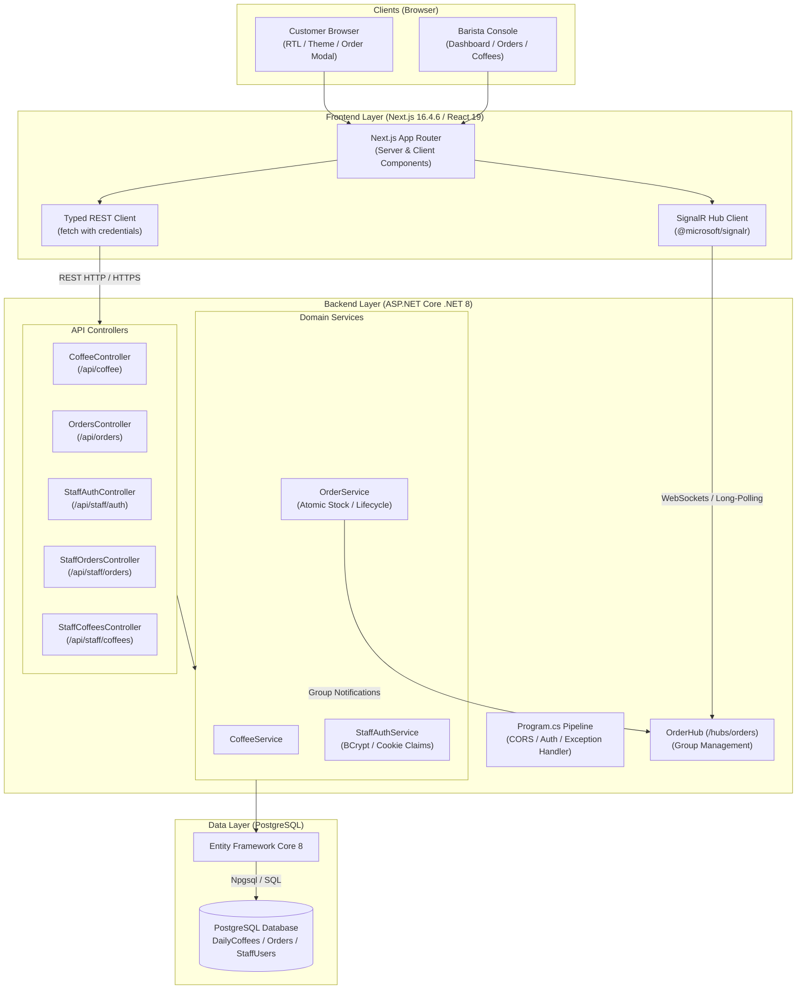
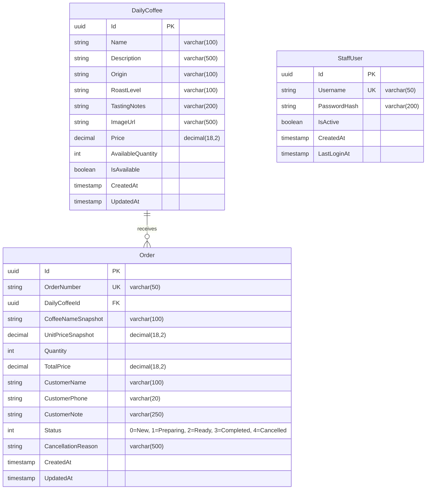

# S-07 — Rukn (رُكن) Specialty Coffee Preorder Platform

[](https://dotnet.microsoft.com/)
[](https://learn.microsoft.com/ef/core/)
[](https://www.postgresql.org/)
[](https://nextjs.org/)
[](https://react.dev/)
[](https://www.typescriptlang.org/)
[](https://tailwindcss.com/)
[](https://learn.microsoft.com/aspnet/core/signalr/)

**Rukn (رُكن)** is an Arabic-first, real-time specialty coffee preorder platform engineered for boutique cafés operating limited-batch daily roasts. It addresses morning peak-hour bottlenecks by enabling customers to discover the daily roast, reserve cups through zero-login preorders, and follow preparation progression in real time, while granting baristas real-time queue orchestration, atomic inventory safeguards, and shift analytics.

---

## Table of Contents

- [1. Product Overview](#1-product-overview)
- [2. Features](#2-features)
- [3. Technology Stack](#3-technology-stack)
- [4. Architecture](#4-architecture)
- [5. Project Structure](#5-project-structure)
- [6. Database Design & Business Rules](#6-database-design--business-rules)
- [7. Getting Started](#7-getting-started)
- [8. Configuration & Environment Variables](#8-configuration--environment-variables)
- [9. API Reference](#9-api-reference)
- [10. Real-Time Communication (SignalR)](#10-real-time-communication-signalr)
- [11. Security Architecture](#11-security-architecture)
- [12. Verification & Build Status](#12-verification--build-status)
- [13. Scope, Limitations & Future Improvements](#13-scope-limitations--future-improvements)
- [14. AI-Assisted Development Disclosure](#14-ai-assisted-development-disclosure)
- [15. Architectural Decision Records](#15-architectural-decision-records)

---

## 1. Product Overview

Specialty coffee shops face unique operational constraints: coffees are single-origin, roasted in small batches, prepared manually (V60, espresso, aeropress), and morning demand spikes create long queues.

Rukn resolves this operational challenge with a streamlined, dual-persona system:

- **Customer Journey**:
  1. Customers access the web application and immediately see **Today's Brew** (قهوة اليوم) with origin details, processing notes, roast level, cup price (MAD), and remaining availability.
  2. Customers trigger the preorder modal, specify cup quantity (1–20), enter customer name and valid Moroccan mobile number, and submit without mandatory account registration.
  3. The system generates an unguessable tracking reference (`RUKN-YYYYMMDD-XXXXXX`), decrements inventory atomically, and displays a live 4-stage tracking timeline.
  4. Customers can track orders at any time via `/track` or cancel before brewing begins.
- **Barista Operational Workflow**:
  1. Staff members sign in through a secure cookie-authenticated portal (`/staff/login`).
  2. The dashboard (`/staff/dashboard`) provides real-time shift metrics (revenue, orders in queue, active roasts, and chart visualizations).
  3. The live orders console (`/staff/orders`) pushes new orders immediately via SignalR without polling. Baristas transition orders sequentially (`New` ➔ `Preparing` ➔ `Ready` ➔ `Completed`) with single-tap actions or cancel with mandatory reasons.
  4. Staff adjust coffee catalog items and stock levels on demand (`/staff/coffees`).
- **Real-Time Synergy**:
  Duplex SignalR messaging guarantees that status transitions made by baristas update customer screens instantaneously, while newly placed customer orders appear on the barista board with zero latency.

---

## 2. Features

### Customer Experience
- **Daily Coffee Spotlight (`/`)**: Displays the active daily offering fetched via `/api/coffee/today`, showing cup price, tasting notes, roast profile, origin, and live remaining cups.
- **Coffee Catalog (`/coffee`)**: Browse the curated archive of specialty roasts with direct modal preorder triggers.
- **Instant Preorder Modal**: Order flow collecting name, Moroccan mobile number (`05/06/07...` or `+212...`), quantity selector, and optional notes.
- **Real-Time Visual Tracking (`/order/[id]`)**: 4-stage progression timeline (جديد ➔ قيد التحضير ➔ جاهز للاستلام ➔ تم التسليم) updated dynamically via SignalR.
- **Order Lookup (`/track`)**: Public order search by reference code (`RUKN-YYYYMMDD-XXXXXX`).
- **Customer Order Cancellation**: Allows customers to cancel their own orders directly from the tracking page provided the order is still in `New` or `Preparing` status, requiring a cancellation reason.
- **RTL-First Arabic UI**: Native Right-to-Left layout powered by `IBM Plex Sans Arabic`, fluid spacing, and mobile touch targets $\ge 44$px.
- **Theme Support**: Seamless toggle between Dark and Light mode across all customer pages.

### Staff Operations
- **Session Authentication (`/staff/login`)**: Secure HTTP-only cookie authentication with sliding expiration.
- **Operations Dashboard (`/staff/dashboard`)**:
  - Live KPI cards: Total orders, today's revenue, active preparations, ready orders, and low-inventory warnings.
  - Interactive Recharts analytics: 7-day/30-day/monthly revenue Area Chart, daily orders Bar Chart, and order status Donut Chart.
  - Live feed of recent preorders and today's coffee status widget.
- **Live Orders Orchestration (`/staff/orders`)**:
  - Multi-status filter tabs (`All`, `New`, `Preparing`, `Ready`, `Completed`, `Cancelled`) and text search (name, phone, order number).
  - One-tap status progression buttons (`بدء التحضير`, `تأكيد الجاهزية`, `تأكيد التسليم`).
  - Safe cancellation with confirmation modal and predefined reason choices.
  - Order details modal showing full customer notes, phone number, and exact timestamps.
- **Coffee & Inventory Management (`/staff/coffees`)**:
  - Create new coffee offerings (`/staff/coffees/new`).
  - Edit existing coffee profiles, origins, roast levels, prices, and tasting notes (`/staff/coffees/[id]/edit`).
  - Inline toggle for coffee availability and instant inventory stock adjustments (`PATCH /api/staff/coffees/{id}/inventory`).
  - Safe deletion safeguards preventing deletion of coffees with associated historical orders.
- **Settings & Profile (`/staff/settings`)**: Theme preferences, session review, and password update functionality.

### Real-Time Capabilities (SignalR)
- **Hub Route**: `/hubs/orders`.
- **Targeted Group Subscriptions**: Customers subscribe strictly to their individual order group (`order_{ORDERNUMBER}`), eliminating public broadcast of personal information.
- **Staff Broadcast Channel**: Authenticated staff join `StaffDashboard` to receive instant `OrderCreated` and `StaffOrderStatusChanged` notifications.
- **Auto-Reconnection**: Resilient reconnection pipeline with exponential backoff and REST state resynchronization upon network recovery.

---

## 3. Technology Stack

| Layer | Technology | Version | Purpose |
| :--- | :--- | :--- | :--- |
| **Backend Runtime** | .NET | `8.0` (`net8.0`) | High-performance C# 12 Web API runtime |
| **Backend Framework** | ASP.NET Core | `8.0` | Dependency injection, routing, and controller pipeline |
| **Database** | PostgreSQL | `15+` | Relational storage with check constraints and ACID transactions |
| **ORM & Migrations** | EF Core / Npgsql | `8.0.11` | Data modeling, migrations, and atomic database execution |
| **Real-Time Engine** | ASP.NET Core SignalR | `8.0` | Duplex WebSocket & long-polling communication |
| **Authentication** | ASP.NET Core Cookie Auth | `8.0` | `HttpOnly`, `SameSite=Lax`, secure cookie session management |
| **Password Hashing** | `BCrypt.Net-Next` | `4.0.3` | Salted password hashing (work factor 11) |
| **API Documentation** | Swashbuckle (Swagger) | `6.6.2` | OpenAPI specification and interactive testing UI |
| **Frontend Framework** | Next.js (App Router) | `16.4.6` | Server and Client React components with Turbopack |
| **Frontend Library** | React | `19.3.0` | Reactive UI and component lifecycle management |
| **Language** | TypeScript | `5.x` | Strict typing across API contracts and UI states |
| **Styling** | Tailwind CSS | `4.3.3` | Utility-first styling with RTL support and dark mode |
| **Charts** | Recharts & `react-is` | `3.11.0` / `19.3.1` | Responsive SVG area, bar, and donut charts |
| **Icons** | Lucide React | `1.77.0` | Consistent iconography |
| **Real-Time Client** | `@microsoft/signalr` | `11.0.0` | WebSocket client with automatic reconnection |

---

## 4. Architecture



### Architectural Layer Responsibilities
- **Frontend Layer**: Delivers server-rendered landing pages for fast initial paint, hydrates client components for interactive order placement, manages local theme state, and maintains persistent SignalR socket subscriptions.
- **Presentation Layer (Controllers & Hub)**: Validates incoming HTTP requests, enforces cookie authorization attributes (`[Authorize]`), defines route contracts, and exposes WebSocket subscription endpoints.
- **Business Domain Layer (Services)**: Encapsulates all business logic, enforces order lifecycle state transitions, validates phone formats and quantity boundaries, manages BCrypt hashing, and coordinates atomic inventory updates.
- **Data Access Layer (EF Core & PostgreSQL)**: Manages relational mapping, applies database-level check constraints, executes atomic decrement updates, and guarantees transactional isolation.

---

## 5. Project Structure

```text
S-07/
├── .agents/                        # Architectural standards, skills & rules
│   ├── rules/                      # Security, architecture & coding guidelines
│   └── skills/                     # Domain engineering skills
├── backend/                        # ASP.NET Core .NET 8 Solution
│   ├── Rukn.sln                    # Visual Studio Solution File
│   └── Rukn.Api/                   # Main Web API Project
│       ├── Controllers/            # REST API Controllers
│       │   ├── CoffeeController.cs
│       │   ├── OrdersController.cs
│       │   ├── StaffAuthController.cs
│       │   ├── StaffCoffeesController.cs
│       │   └── StaffOrdersController.cs
│       ├── Data/                   # Database Context, Seed & Migrations
│       │   ├── Migrations/         # Sequential EF Core Migrations
│       │   ├── AppDbContext.cs     # Entity configurations & constraints
│       │   └── DbInitializer.cs    # Schema ensure-created & seed data
│       ├── DTOs/                   # Data Transfer Objects & records
│       ├── Entities/               # Domain Models (DailyCoffee, Order, StaffUser)
│       ├── Enums/                  # OrderStatus enum definition
│       ├── Exceptions/             # Domain exceptions & validation errors
│       ├── Hubs/                   # SignalR OrderHub implementation
│       ├── Middleware/             # Global exception handling & ProblemDetails
│       ├── Services/               # Business Service Contracts & Implementations
│       │   ├── Interfaces/
│       │   └── Implementations/
│       ├── appsettings.json        # Production configuration template
│       ├── appsettings.Development.json
│       ├── Program.cs              # DI container, pipeline & middleware setup
│       └── Rukn.Api.csproj         # Package references & build settings
├── frontend/                       # Next.js 16.4.6 App Router Project
│   ├── app/                        # App Router Routes & Pages
│   │   ├── coffee/                 # Public coffee catalog page
│   │   ├── order/[id]/             # Real-time customer order tracking page
│   │   ├── staff/                  # Staff portal
│   │   │   ├── coffees/            # Coffee inventory & catalog management
│   │   │   ├── dashboard/          # Metrics, KPI cards & Recharts analytics
│   │   │   ├── login/              # Cookie authentication screen
│   │   │   ├── orders/             # Live order queue management
│   │   │   └── settings/           # Staff settings & password change
│   │   ├── track/                  # Order reference search page
│   │   ├── globals.css             # Tailwind CSS & theme tokens
│   │   ├── layout.tsx              # Root HTML, IBM Plex Sans Arabic & providers
│   │   └── page.tsx                # Customer landing page (Today's Coffee)
│   ├── components/                 # Reusable React components
│   │   ├── charts/                 # Recharts wrapper components
│   │   ├── coffee/                 # CoffeeCard & PreorderModal
│   │   ├── dashboard/              # Stats grids & recent orders feed
│   │   └── orders/                 # Staff order cards & modals
│   ├── lib/                        # API client & SignalR connection builder
│   ├── types/                      # TypeScript domain types & interfaces
│   ├── next.config.ts              # Next.js compiler & build configuration
│   ├── package.json                # Dependencies & npm scripts
│   └── tsconfig.json               # TypeScript strict configuration
├── .env.example                    # Backend environment configuration template
├── DECISIONS.md                    # Architecture Decision Records (ADRs)
└── README.md                       # Project documentation
```

---

## 6. Database Design & Business Rules

### Entity Relationship Model



### Core Business Rules
1. **Atomic Inventory Reservation**:
   Stock decrement occurs via an atomic database statement wrapped inside an explicit database transaction:
   ```sql
   UPDATE "DailyCoffees"
   SET "AvailableQuantity" = "AvailableQuantity" - @Quantity, "UpdatedAt" = @Now
   WHERE "Id" = @DailyCoffeeId AND "AvailableQuantity" >= @Quantity;
   ```
   If zero rows are affected, the transaction aborts and an `OutOfStockException` is thrown, eliminating race conditions under concurrency without external distributed lock infrastructure.
2. **Snapshot Immutability**:
   When an order is created, `CoffeeNameSnapshot` and `UnitPriceSnapshot` are permanently copied to the order record. Subsequent price modifications or title changes to `DailyCoffees` do not alter historical accounting records.
3. **Order Lifecycle Transitions**:
   State transitions are strictly forward-progressing:
   - `New (0)` ➔ `Preparing (1)`
   - `Preparing (1)` ➔ `Ready (2)`
   - `Ready (2)` ➔ `Completed (3)`
   - `New (0)` ➔ `Cancelled (4)`
   - `Preparing (1)` ➔ `Cancelled (4)`
   Any illegal transition (e.g., reverting `Ready` to `New`, or cancelling a `Completed` order) is rejected with a domain validation error.
4. **Cancellation Stock Restoration & Check Constraint**:
   Cancelling an order restores the reserved cups back to `DailyCoffees.AvailableQuantity` within the same transaction. An EF Core migration enforces database check constraint `CK_Orders_CancellationReason`:
   ```sql
   ("Status" = 4 AND "CancellationReason" IS NOT NULL AND length(trim("CancellationReason")) > 0)
   OR
   ("Status" <> 4 AND "CancellationReason" IS NULL)
   ```

---

## 7. Getting Started

### Prerequisites
- **.NET SDK**: Version `8.0` or higher ([Download .NET 8](https://dotnet.microsoft.com/download/dotnet/8.0))
- **Node.js**: Version `20.x` or higher ([Download Node.js](https://nodejs.org/))
- **PostgreSQL**: Version `15+` running locally or via Docker
- **Git**

### 1. Clone the Repository
```bash
git clone https://github.com/mrasgk/S-07.git
cd S-07
```

### 2. Backend Setup
1. Navigate to the backend directory:
   ```bash
   cd backend/Rukn.Api
   ```
2. Configure your database connection string in `appsettings.Development.json`:
   ```json
   {
     "ConnectionStrings": {
       "DefaultConnection": "Host=localhost;Port=5432;Database=rukn_db;Username=postgres;Password=your_password"
     }
   }
   ```
3. Restore dependencies:
   ```bash
   dotnet restore
   ```
4. Apply database migrations:
   ```bash
   dotnet ef database update
   ```
   *(Note: `DbInitializer.cs` also runs auto-migration/seeding on startup via `EnsureCreatedAsync` if EF tools are not installed globally).*
5. Run the backend API:
   ```bash
   dotnet run
   ```
   The backend will start on `http://localhost:5000` (Swagger UI available at `http://localhost:5000/swagger`).

### 3. Frontend Setup
1. Open a new terminal and navigate to the frontend directory:
   ```bash
   cd frontend
   ```
2. Verify environment settings in `.env.local` (or copy from `frontend/.env.example`):
   ```bash
   cp .env.example .env.local
   ```
   Ensure `NEXT_PUBLIC_API_URL` is set:
   ```env
   NEXT_PUBLIC_API_URL=http://localhost:5000
   ```
3. Install dependencies:
   ```bash
   npm install
   ```
4. Start the development server:
   ```bash
   npm run dev
   ```
   The frontend application will be accessible at `http://localhost:3000`.

---

## 8. Configuration & Environment Variables

### Backend Configuration (`appsettings.json` / Environment Variables)

| Key | Description | Example / Default |
| :--- | :--- | :--- |
| `ConnectionStrings:DefaultConnection` | PostgreSQL connection string | `Host=localhost;Port=5432;Database=rukn_db;Username=postgres;Password=...` |
| `Cors:AllowedOrigins` | Array of authorized client origins | `["http://localhost:3000"]` |
| `DevStaff:Username` | Seed staff account username | `baristarukn` |
| `DevStaff:Password` | Seed staff account password (development only) | Configurable via environment in production |

> [!IMPORTANT]
> In production environments, override `DevStaff:Password` and `ConnectionStrings:DefaultConnection` using environment variables (`CONNECTIONSTRINGS__DEFAULTCONNECTION` and `DEVSTAFF__PASSWORD`). Never commit raw credentials to version control.

### Frontend Configuration (`frontend/.env.local`)

| Variable | Description | Safe Default |
| :--- | :--- | :--- |
| `NEXT_PUBLIC_API_URL` | Base HTTP endpoint for the ASP.NET Core API | `http://localhost:5000` |

---

## 9. API Reference

### Public Coffee Endpoints
| Method | Endpoint | Description | Auth Required |
| :--- | :--- | :--- | :--- |
| `GET` | `/api/coffee/today` | Fetch today's featured roast and stock availability | None |
| `GET` | `/api/coffee` | List all available specialty coffees in the catalog | None |

### Customer Order Endpoints
| Method | Endpoint | Description | Auth Required |
| :--- | :--- | :--- | :--- |
| `POST` | `/api/orders` | Submit a new preorder with atomic stock decrement | None |
| `GET` | `/api/orders/{orderNumber}` | Retrieve sanitized order tracking details by reference code | None |
| `PATCH` | `/api/orders/{orderNumber}/cancel` | Cancel an order (`New` or `Preparing`) with mandatory reason | None |

### Staff Authentication Endpoints
| Method | Endpoint | Description | Auth Required |
| :--- | :--- | :--- | :--- |
| `POST` | `/api/staff/auth/login` | Authenticate staff and set secure session cookie | None |
| `POST` | `/api/staff/auth/logout` | Revoke session and clear authentication cookie | Cookie Auth |
| `GET` | `/api/staff/auth/me` | Return identity details of the current staff member | Cookie Auth |
| `POST` | `/api/staff/auth/change-password` | Update authenticated staff user password | Cookie Auth |

### Staff Order Management Endpoints
| Method | Endpoint | Description | Auth Required |
| :--- | :--- | :--- | :--- |
| `GET` | `/api/staff/orders` | Retrieve paginated orders with status and search filters | Cookie Auth |
| `GET` | `/api/staff/orders/{id}` | Retrieve full internal order details by GUID | Cookie Auth |
| `GET` | `/api/staff/dashboard/recent-orders` | Fetch the 5 most recent orders for dashboard feed | Cookie Auth |
| `PATCH` | `/api/staff/orders/{id}/status` | Advance order status (`New` ➔ `Preparing` ➔ `Ready` ➔ `Completed`) | Cookie Auth |
| `PATCH` | `/api/staff/orders/{id}/cancel` | Cancel order from staff console with reason & stock restore | Cookie Auth |
| `GET` | `/api/staff/dashboard/summary` | Fetch dashboard KPI summary and 7-day revenue points | Cookie Auth |
| `GET` | `/api/staff/dashboard/analytics` | Fetch analytics for period (`7d`, `30d`, `month`) | Cookie Auth |

### Staff Coffee Management Endpoints
| Method | Endpoint | Description | Auth Required |
| :--- | :--- | :--- | :--- |
| `GET` | `/api/staff/coffees` | List all coffees (including unavailable) for management | Cookie Auth |
| `GET` | `/api/staff/coffees/{id}` | Get specific coffee entity details by GUID | Cookie Auth |
| `POST` | `/api/staff/coffees` | Create a new coffee product offering | Cookie Auth |
| `PUT` | `/api/staff/coffees/{id}` | Update existing coffee profile and attributes | Cookie Auth |
| `PATCH` | `/api/staff/coffees/{id}/availability` | Toggle coffee active/inactive visibility boolean | Cookie Auth |
| `PATCH` | `/api/staff/coffees/{id}/inventory` | Update available cup quantity in stock | Cookie Auth |
| `DELETE` | `/api/staff/coffees/{id}` | Delete a coffee product (blocked if orders exist) | Cookie Auth |

---

## 10. Real-Time Communication (SignalR)

### Hub Path: `/hubs/orders`

The platform uses ASP.NET Core SignalR with fallback to long-polling for environments where WebSockets are restricted.

### Hub Methods (Client Invocation)
- **`JoinOrderTracking(string orderNumber)`**:
  - Invoked by the customer tracking page.
  - Adds the connection to group `order_{ORDERNUMBER}`.
  - Ensures customers receive notifications strictly for their designated order.
- **`JoinStaffDashboard()`**:
  - Invoked by staff clients upon dashboard initialization.
  - Checks `Context.User.Identity.IsAuthenticated`. Unauthenticated connections are rejected and logged.
  - Adds authenticated staff connections to group `StaffDashboard`.

### Hub Events (Server Broadcasts)

#### 1. `OrderStatusUpdated`
- **Target Group**: `order_{ORDERNUMBER}` (Customer channel)
- **Trigger**: Barista changes order status or order is cancelled.
- **Payload Example**:
  ```json
  {
    "orderNumber": "RUKN-20261122-A1B2C3",
    "status": "Ready",
    "statusArabic": "جاهز",
    "cancellationReason": null,
    "updatedAt": "2026-11-22T14:30:00Z"
  }
  ```

#### 2. `OrderCreated`
- **Target Group**: `StaffDashboard` (Staff channel)
- **Trigger**: New preorder successfully placed and committed to the database.
- **Payload Example**:
  ```json
  {
    "id": "e4f8b910-1234-4567-89ab-cdef01234567",
    "orderNumber": "RUKN-20261122-A1B2C3",
    "coffeeNameSnapshot": "إثيوبيا سيداما",
    "quantity": 2,
    "totalPrice": 70.00,
    "customerName": "أحمد",
    "status": "New",
    "statusArabic": "جديد",
    "createdAt": "2026-11-22T14:25:00Z"
  }
  ```

#### 3. `StaffOrderStatusChanged`
- **Target Group**: `StaffDashboard` (Staff channel)
- **Trigger**: An order is advanced or cancelled.
- **Payload Example**:
  ```json
  {
    "id": "e4f8b910-1234-4567-89ab-cdef01234567",
    "orderNumber": "RUKN-20261122-A1B2C3",
    "status": "Preparing",
    "statusArabic": "قيد التحضير",
    "cancellationReason": null,
    "updatedAt": "2026-11-22T14:28:00Z"
  }
  ```

---

## 11. Security Architecture

### Implemented Security Controls
- **Cookie-Based Staff Authentication**: Employs `HttpOnly`, `SameSite=Lax`, and `SecurePolicy=SameAsRequest` cookies (`Rukn.Staff.Auth`), mitigating client-side script token exfiltration (XSS).
- **Password Protection**: Passwords hashed using `BCrypt.Net-Next` with a work factor of 11.
- **Customer Privacy & IDOR Protection**: The public tracking endpoint (`/api/orders/{orderNumber}`) returns a sanitized `CustomerOrderResponse` that omits customer phone numbers and staff operational notes, accessible only via random alphanumeric identifiers (`RUKN-YYYYMMDD-XXXXXX`).
- **Atomic Concurrency Defense**: Database-level stock reservation (`ExecuteUpdateAsync`) prevents overselling race conditions during traffic spikes.
- **Input Validation**: Server-side normalization and validation of Moroccan telephone numbers (`MoroccanPhoneValidator`), character length boundaries, and quantity constraints (1–20).
- **CORS Restrictions**: Explicit origin whitelist restricting API access to configured frontend hosts.
- **SignalR Authorization**: Joining the `StaffDashboard` group requires an authenticated identity; unauthenticated connection attempts are refused.

### Operational Boundaries & Recommendations
- **Single-Instance SignalR**: SignalR runs in-memory. Multi-server production deployments require a backplane (Redis or PostgreSQL `LISTEN`/`NOTIFY`).
- **Rate Limiting**: Public endpoints (`POST /api/orders`) would benefit from IP-based rate limiting (e.g., ASP.NET Core RateLimiter) to mitigate automated spam.
- **Payment Processing**: Assumes in-store settlement upon order pickup; online payment gateways (CMI/Stripe) are out of scope for the current MVP.

---

## 12. Verification & Build Status

The repository components have been directly verified on the current codebase:

| Component / Task | Command | Verified Outcome |
| :--- | :--- | :--- |
| **Backend Dependencies** | `dotnet restore backend/Rukn.sln` | **Clean**: All projects up-to-date for restore. |
| **Backend Compilation** | `dotnet build backend/Rukn.sln` | **Verified**: Source compiles without syntax or type errors. |
| **Frontend Production Build** | `npm run build` (Next.js 16.4.6 Turbopack) | **Passed**: 13/13 routes compiled successfully; TypeScript passed with 0 errors. |
| **Frontend Code Quality** | `npm run lint` (ESLint 9) | **Passed**: 0 errors (12 non-breaking stylistic warnings). |
| **Database Migrations** | `UpdatedSchema`, `ExpandOrderStatus`, `AddCancellationReason` | **Verified**: Sequential schema migrations present and validated. |

---

## 13. Scope, Limitations & Future Improvements

### Current Scope (MVP)
- Focused single-origin daily coffee ordering workflow.
- High-efficiency preordering without account creation friction.
- Real-time order progress tracking and barista queue management.
- Complete operational analytics and inventory controls.

### Intentionally Excluded from MVP
- Integrated payment gateway processing (settlement occurs upon pickup).
- Multi-item shopping cart (specialty coffee focus on single daily roasts).
- Customer accounts and loyalty point tracking.

### Recommended Future Enhancements
1. **SignalR Distributed Backplane**: Integration of Redis Pub/Sub to allow horizontal API scaling.
2. **Audio Alerts for Baristas**: Audio cues via the Web Audio API when new preorders arrive on the staff console.
3. **Web Push Notifications**: Service Worker integration to deliver browser notifications when an order reaches `Ready`, even if the customer's tab is closed.
4. **Automated Unit & Integration Test Suite**: Adding an integration test harness (`WebApplicationFactory`) for automated CI/CD pipeline verification.

---

## 14. AI-Assisted Development Disclosure

AI assistance was utilized as an engineering productivity tool throughout the development of Rukn, specifically for:
- Evaluating architectural trade-offs between monolithic and decoupled architectures.
- Drafting and reviewing Entity Framework Core migration strategies.
- Assisting in the implementation of RTL styling patterns and Recharts data bindings.
- Code review, refactoring suggestions, and technical documentation auditing.

All architectural decisions, business rules, code adaptations, security reviews, and final validations were conducted and approved by the engineering author.

---

## 15. Architectural Decision Records

For detailed justifications regarding architecture, database constraints, lifecycle choices, and trade-offs, refer to the project's Architectural Decision Records:

👉 **[DECISIONS.md](DECISIONS.md)**
